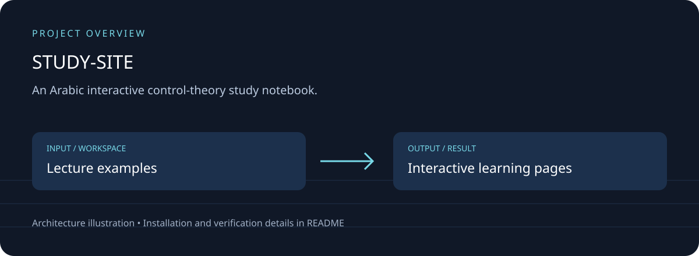
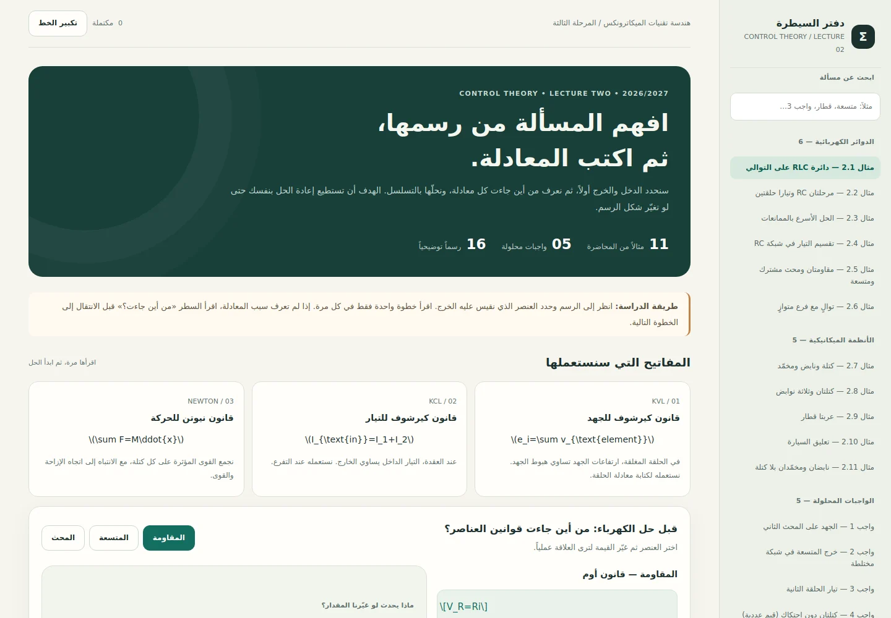

# دفتر السيطرة — Lecture Two

## Download, setup and project overview

An Arabic interactive control-theory study notebook.

Worked lecture examples; explanatory steps; SVG diagrams; interactive response experiments; progress storage.



### Running application



Actual local browser capture from this maintenance pass; a screenshot alone does not verify every feature.

[Download source ZIP](https://github.com/ahpa5246-lgtm/STUDY-SITE/archive/refs/heads/main.zip) · [Changes and branches](https://github.com/ahpa5246-lgtm/STUDY-SITE/branches) · [Verification notes](docs/QUALITY_REVIEW.md)

The ZIP contains source code. Installation steps and external runtime requirements are listed below.

```bash
git clone https://github.com/ahpa5246-lgtm/STUDY-SITE.git
cd STUDY-SITE
```

From the repository directory:

```text
python -m http.server 8080 --bind 127.0.0.1
# Open http://127.0.0.1:8080
```

The diagram is a project illustration. Test results and runtime limitations are recorded in [the review](docs/QUALITY_REVIEW.md); it is not a production-readiness certification.


موقع عربي تفاعلي يشرح **جميع مسائل المحاضرة الثانية في نظرية السيطرة** اعتماداً على ملزمة المرحلة الثالثة لهندسة تقنيات الميكاترونكس (2026–2027).

## المحتوى

- **11 مثالاً محلولاً:** Examples 2.1–2.11 (دوائر كهربائية وأنظمة ميكانيكية).
- **5 واجبات محلولة:** كل واجبات الصفحة الأخيرة من الملزمة.
- **87 خطوة شرح:** في كل خطوة معادلة وتفسير: «من أين جاءت؟».
- **رسوم SVG توضيحية** لكل بنية نظام أو دائرة، وأسئلة تحقق من الفهم.
- **تجربتان تفاعليتان:** تغيّر قيم عناصر دائرة RLC أو نظام كتلة/نابض/مخمّد وترى الاستجابة الزمنية.
- حفظ علامة الإنجاز محلياً داخل المتصفح.

## التشغيل

افتح \`index.html\` عبر خادم محلي بسيط، أو فعّل GitHub Pages. الصفحة الأساسية هي \`index.html\`، وتعتمد على \`style.css\` و\`data.js\` و\`app.js\`.

من المستودع على GitHub:

1. ادخل إلى **Settings → Pages**.
2. اختر **Deploy from a branch**.
3. اختر الفرع **main** والمجلد **/(root)** ثم اضغط **Save**.
4. بعد اكتمال النشر سيكون الرابط المتوقع: \`https://ahpa5246-lgtm.github.io/STUDY-SITE/\`.

تحتاج اتصالاً بالإنترنت لعرض المعادلات بخط رياضي عبر MathJax، ولتنزيل الخط العربي من Google Fonts. الشرح والخطوات والرسوم والمحاكاة مكتوبة داخل ملفات المستودع، ولا تحتاج إلى خادم خلفي.

## ملاحظات علمية

- الحلول مبنية على ملزمة المستخدم؛ الأخطاء التحريرية الملحوظة في مثالَي 2.9 و2.10 موضحة في موضعها داخل الدرس.
- الرسوم التعليمية مصنوعة خصيصاً للموقع، وهي مبسطة للمراجعة وليست نسخاً حرفية من الملزمة.
- المحاكاة العددية لتوضيح الاستجابة فقط، وليست بديلاً عن تحليل الاستقرار أو المحاكاة الهندسية المعتمدة.

الملفات: \`index.html\` واجهة الموقع، \`style.css\` التصميم، \`data.js\` محتوى جميع المسائل، \`app.js\` الرسوم والتفاعل والاختبارات والمحاكاة.
